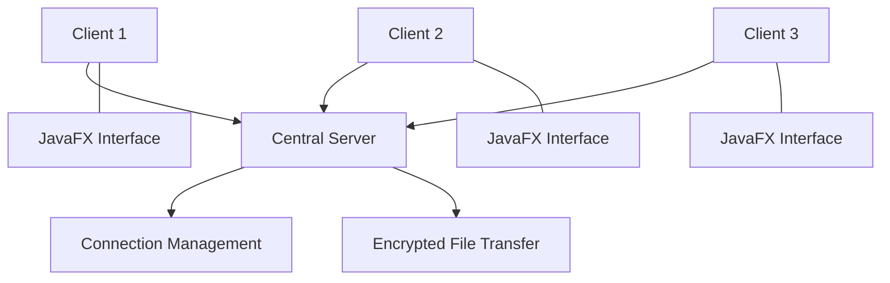

# 📁 XShare — Cross-Platform File Sharing App

**XShare** is a cross-platform file-sharing application developed in Java that enables secure file transfers between devices over a network using AES encryption. Built with a server-client architecture and a JavaFX user interface, it provides an interactive way to share files, manage client connections, and monitor transfer progress.

## ✨ Features

- 🌍 **Cross-Platform Support:** Runs on Windows, macOS, and Linux on systems that support the required Java runtime.
- 🔐 **Secure File Transfers:** Uses AES encryption to protect files during transfer.
- 🖥️ **JavaFX User Interface:** Provides an interactive desktop interface for file selection, client management, and transfer monitoring.
- ⚡ **Multithreaded Operations:** Supports simultaneous file transfers through concurrent processing.
- 📂 **Drag-and-Drop Support:** Makes file selection easier with drag-and-drop functionality.
- 🔗 **Client-Server Architecture:** Uses a centralized server to manage multiple client connections.
- 📊 **Transfer Progress Tracking:** Displays real-time progress updates during file transfers.

## 🛠️ Technology Stack

| Technology | Purpose |
|---|---|
| Java | Core application development |
| JavaFX | Desktop user interface |
| TCP Sockets | Client-server network communication |
| AES Encryption | Protecting file contents during transfer |
| Multithreading | Handling concurrent operations and file transfers |
| Java File I/O | Reading, writing, and managing files |

## 🏗️ System Architecture

XShare follows a client-server architecture in which multiple clients connect to a central server to exchange files.



### How It Works

1. **Connect:** Clients connect to the central server over the network.
2. **Select:** A user selects a file using the JavaFX interface or drag-and-drop.
3. **Encrypt:** The file is encrypted using AES before transmission.
4. **Transfer:** The application transfers the encrypted data through the network.
5. **Track:** The interface updates the transfer progress while the operation is running.
6. **Receive:** The receiving side processes the transferred data and decrypts it using the appropriate key.

## 🔐 Security

XShare uses AES encryption to protect file contents during transfer.

- **Confidentiality:** Encryption helps prevent unauthorized parties from reading intercepted file contents.
- **Secure Key Handling:** The encryption key must be shared or established securely between communicating parties.
- **Data Integrity:** For production use, authenticated encryption, such as AES-GCM, is preferable because encryption alone does not guarantee that transferred data has not been modified.

## ⚙️ Getting Started

### Prerequisites

- Java Development Kit (JDK) compatible with the project
- IntelliJ IDEA or Eclipse
- JavaFX SDK or dependencies, as required by the project configuration
- Network access between the server and client devices

### Installation

**1. Clone the repository**

```bash
git clone https://github.com/Toofail-ahmad/XShare.git
cd XShare
```

**2. Open the project**

Import the project into IntelliJ IDEA or Eclipse and configure the required JDK and JavaFX dependencies.

**3. Configure the connection**

Set the server host and port according to the project's configuration. Ensure that the server is reachable from the client devices and that the required firewall rules permit the connection.

**4. Start the server**

Run the server application's main class.

**5. Start the clients**

Launch the client application on the same device or other devices on the network. Connect to the server and begin sharing files.

*Note: Exact run commands and configuration values depend on the project's current source code and build configuration.*

## 💡 Use Cases

- Sharing files between computers on a local network
- Transferring documents between supported operating systems
- Learning Java network programming and client-server architecture
- Exploring encryption, multithreading, and desktop application development

## 🚀 Future Improvements

- Add transfer resumption for interrupted connections.
- Introduce stronger authentication and client authorization.
- Add transfer history and file metadata.
- Improve encryption key exchange and management.
- Add automated tests for network failures and concurrent transfers.
- Package the application for easier installation across operating systems.

## 👨‍💻 Author

**Tufail Ahmad**

GitHub: [Toofail-ahmad](https://github.com/Toofail-ahmad)

## 📄 License

Add a license file to the repository if you intend to distribute the project under an open-source license.

---

**XShare — Simple, secure, cross-platform file sharing with Java.**
